# Depom · Stok ve Depo Yönetimi

[](https://github.com/mustafagulturk/stok-yonetimi/actions/workflows/ci.yml)

Birden fazla depo ile çalışan işletmeler için stok takibi ve satın alma uygulaması. Depolar arasında transfer, sayım, satın alma siparişinden mal kabulü ve kritik stok uyarıları tek yerde yapılır. Backend **ASP.NET Core 8 Web API** ile, arayüz **React + TypeScript** ile yazıldı.

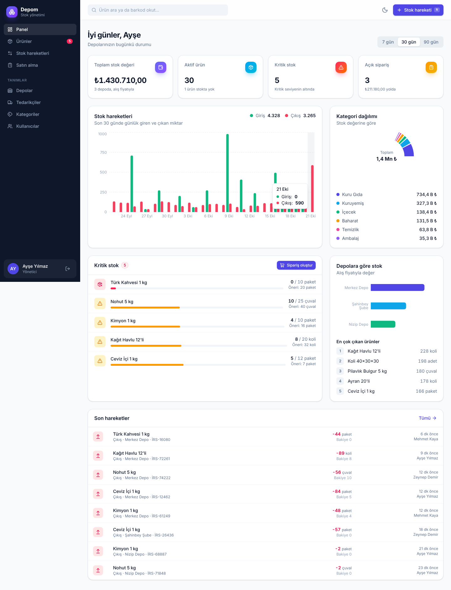

## Neler yapılabiliyor?

**Stok hareketleri**
- Giriş, çıkış, depolar arası transfer ve sayım (sayılan miktarı girince fark otomatik yazılır)
- Her hareket değiştirilemeyen bir kayıt olarak tutulur: kim, ne zaman, hangi belgeyle, hareket sonrası bakiye
- Yetersiz stokta çıkış yapılamaz, arayüz de bunu kaydetmeden önce gösterir (`130 → 110 paket`)
- Her yerden `N` kısayolu ile hızlı hareket penceresi

**Ürünler**
- Stok kodu, barkod, kategori, birim, alış/satış fiyatı ve kritik seviye
- Arama, kategori/depo/stok durumu filtreleri, sıralama, sayfalama
- Barkod okuyucu desteği: okuyucu kodu yazıp Enter'a bastığında ürün doğrudan bulunur
- Destekleyen tarayıcılarda (Chrome, Android) **kamerayla barkod okutma**
- Hareketi olan ürün silinmez, geçmiş bozulmasın diye pasife alınır
- Stok listesini Excel'de açılabilen CSV olarak indirme

**Satın alma**
- Taslak → Sipariş verildi → Kısmen teslim → Teslim alındı akışı
- **Kısmi mal kabul**: gelen miktar girilir, stoğa işlenir, kalan sonra teslim alınabilir
- Mal kabulünde ürünün alış fiyatı güncellenir, hareketler sipariş numarasıyla bağlanır
- **Kritik stoktan tek tıkla sipariş**: önerilen miktar, stoğu kritik seviyenin iki katına çıkaracak kadardır ve yolda olan siparişler düşülür

**Panel ve raporlar**
- Toplam stok değeri, kritik ve tükenen ürünler, açık sipariş tutarı
- 7/30/90 günlük giriş-çıkış grafiği, kategori ve depo bazında stok değeri
- En çok çıkan ürünler, son hareketler

**Kullanıcılar ve yetki**
- İki rol: **Yönetici** (tanımlar, kullanıcılar, iptal) ve **Depo personeli** (hareket, sipariş, mal kabul)
- JWT ile oturum, giriş denemelerine hız sınırı

**Arayüz**
- Açık/koyu tema, mobil uyumlu, klavyeyle kullanılabilir pencereler, yükleniyor iskeletleri

## Ekran görüntüleri

| Ürünler | Ürün detayı |
|---|---|
| 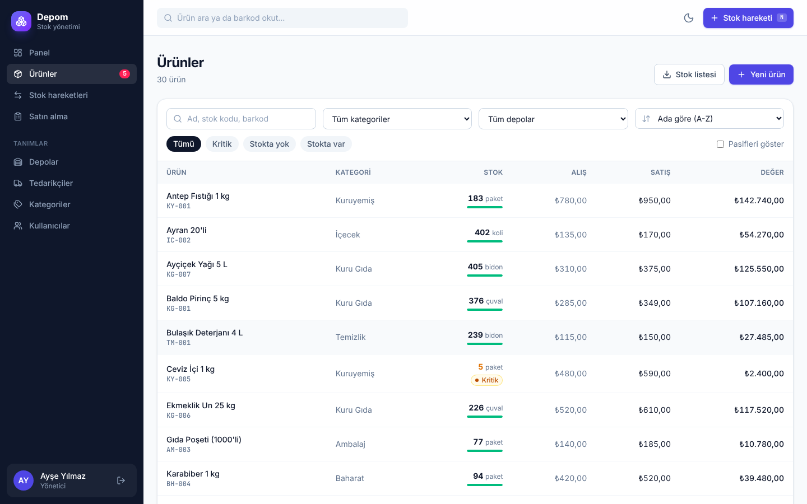 | 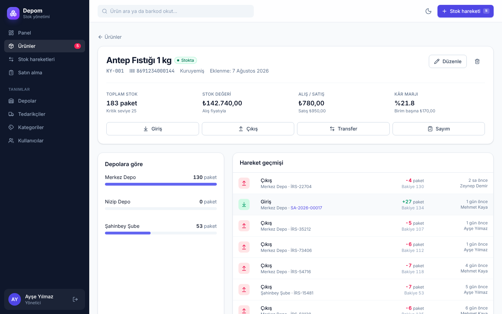 |

| Stok hareketi (transfer) | Hareket geçmişi |
|---|---|
| 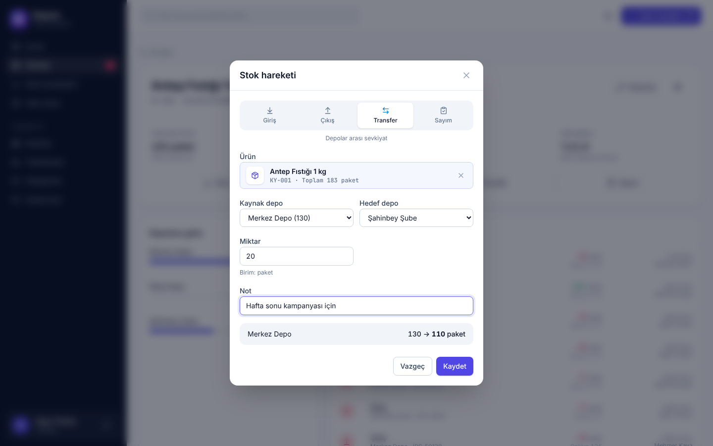 | 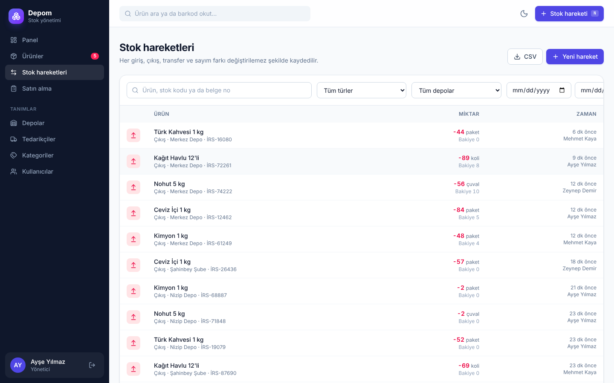 |

| Kritik stoktan sipariş | Mal kabul |
|---|---|
| 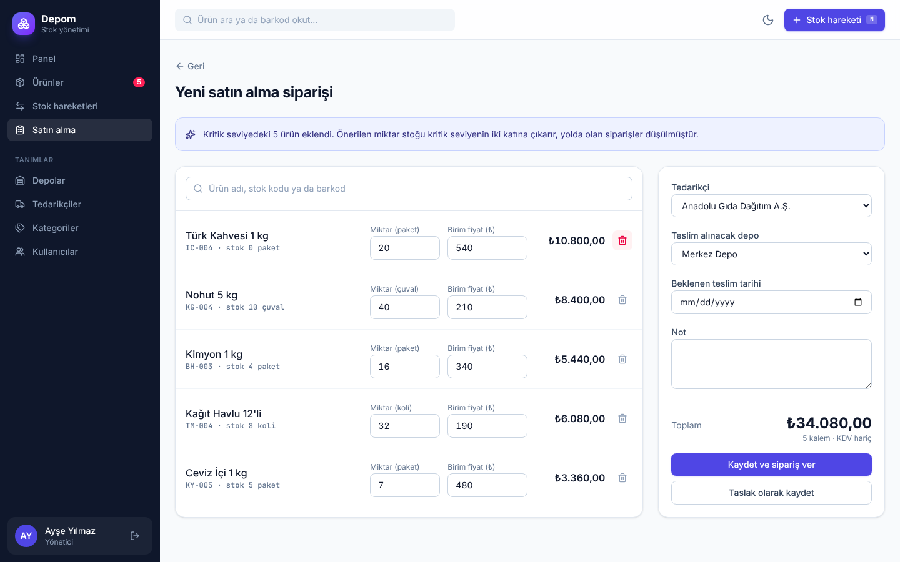 | 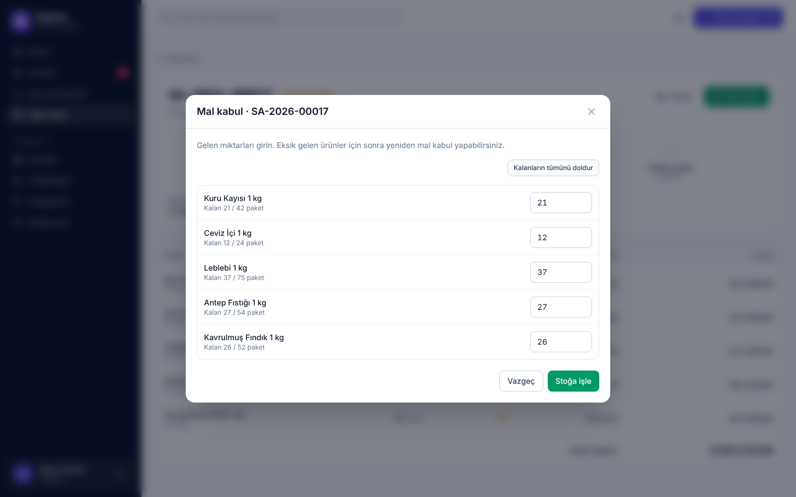 |

| Sipariş detayı | Depolar |
|---|---|
| 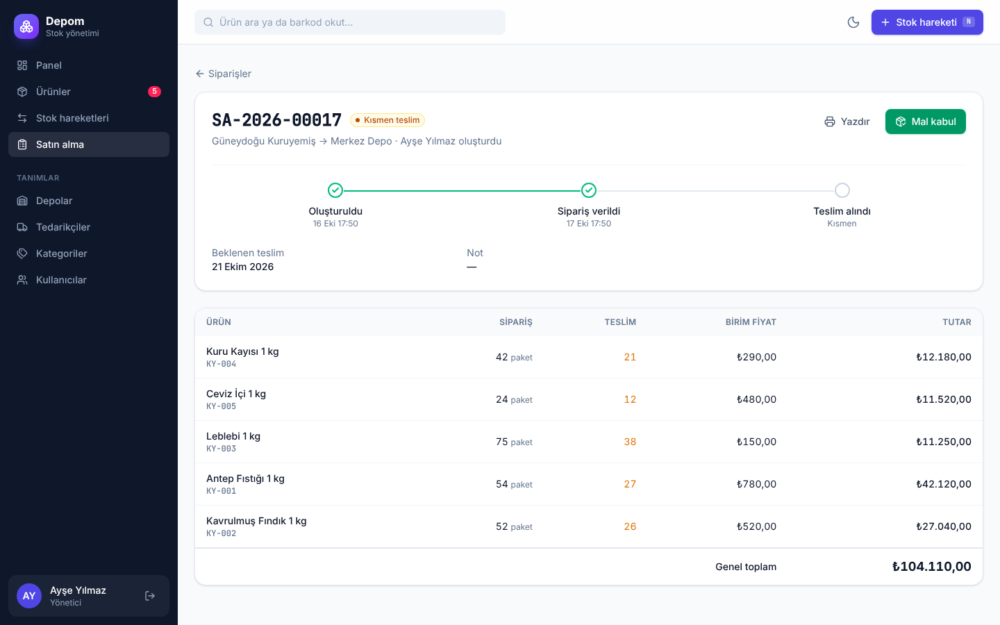 | 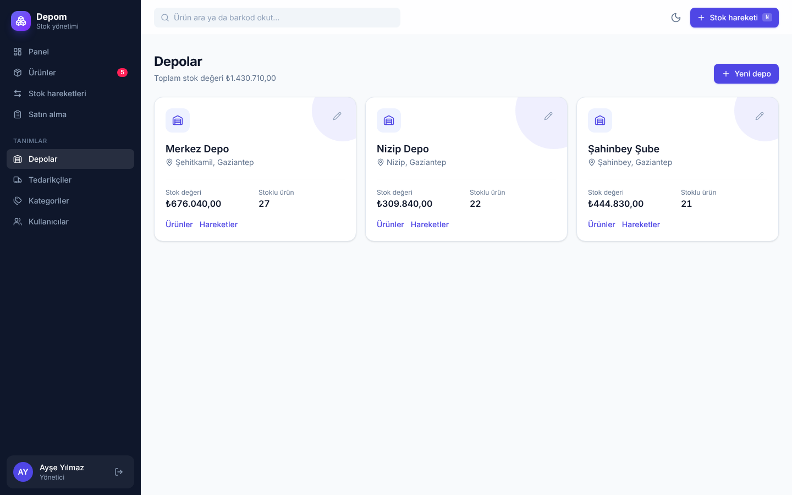 |

| Koyu tema | Mobil | Giriş |
|---|---|---|
| 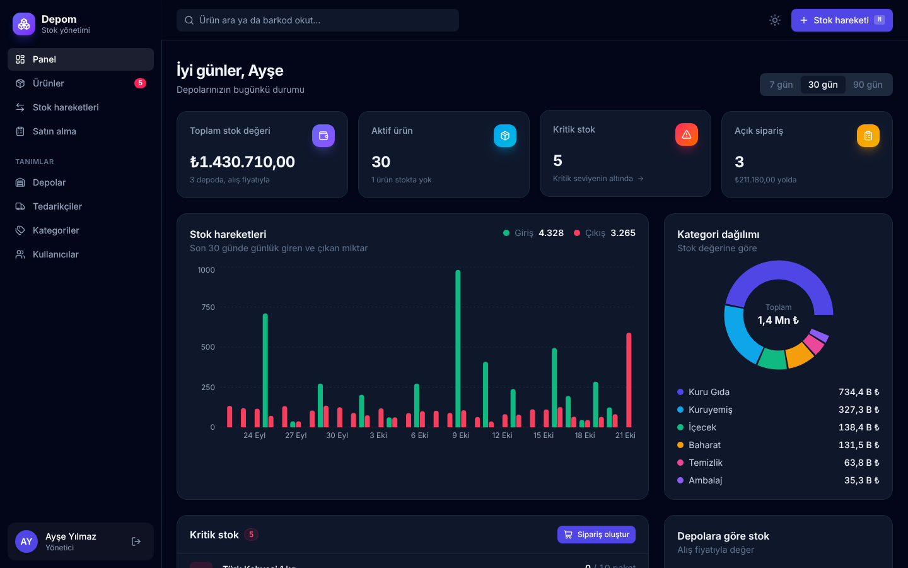 | 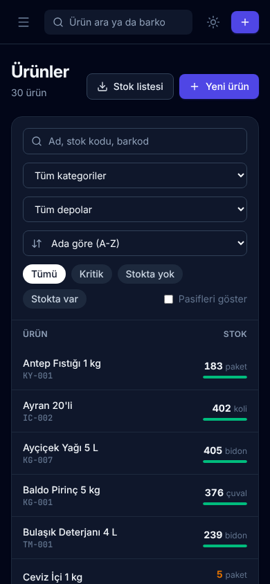 | 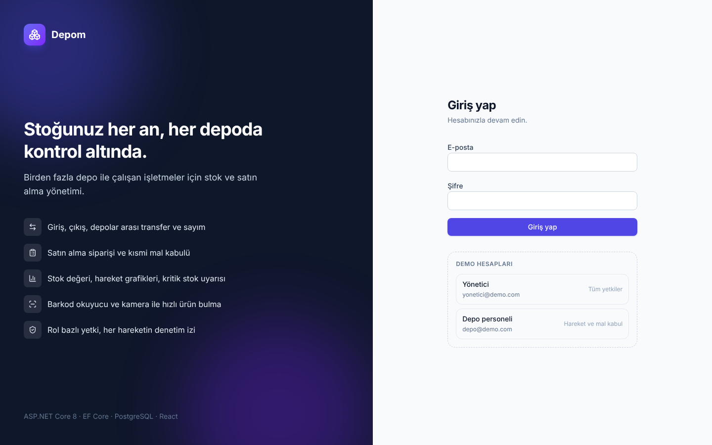 |

## Teknolojiler

| Katman | Kullanılanlar |
|---|---|
| Backend | ASP.NET Core 8 Web API (controller tabanlı), Entity Framework Core 8, Npgsql |
| Veritabanı | PostgreSQL 16, EF Core migration'ları |
| Kimlik | JWT Bearer, BCrypt, rol bazlı yetkilendirme, rate limiting |
| Frontend | React 19, TypeScript, Vite, Tailwind CSS 4, TanStack Query, React Router, Recharts |
| Test | xUnit + WebApplicationFactory ile gerçek PostgreSQL üzerinde entegrasyon testleri |
| Altyapı | Docker (çok aşamalı tek imaj), docker-compose, GitHub Actions CI |

## Öne çıkan teknik kararlar

**Eşzamanlı işlemlerde stok eksiye düşmez.** Stok, "oku, kontrol et, yaz" yerine tek bir koşullu SQL ile değişir:

```sql
UPDATE "StockLevels" SET "Quantity" = "Quantity" + @delta
WHERE "ProductId" = @p AND "WarehouseId" = @w AND "Quantity" + @delta >= 0
RETURNING "Quantity"
```

Satır dönmezse stok yetersizdir. Veritabanında ayrıca `Quantity >= 0` kısıtı var. Testlerde aynı ürüne 25 eşzamanlı çıkış isteği gönderiliyor: stokta 10 adet varsa tam 10'u başarılı oluyor, kalan 15'i `409` alıyor.

**Hareket defteri.** `StockMovements` tablosu sadece eklenir, hiç güncellenmez. Anlık stok (`StockLevels`) ile hareket geçmişi aynı veritabanı işleminde yazılır, bu yüzden birbirini her zaman tutar. Transferin iki ayağı ortak bir `TransferId` ile bağlıdır, biri başarısız olursa ikisi de geri alınır.

**Satın alma durum makinesi.** Sadece taslaklar düzenlenebilir, sadece verilmiş siparişler teslim alınabilir, mal kabulü yapılmış sipariş iptal edilemez. Aynı siparişe iki kişinin aynı anda mal kabul yapması `SELECT ... FOR UPDATE` ile engellenir. Sipariş numaraları (`SA-2026-00012`) bir PostgreSQL sequence'ından gelir, çakışmaz.

**Hatalar Türkçe ve tutarlı.** İş kuralı ihlalleri `AppException` olarak fırlatılır ve `ProblemDetails` formatında döner (`400`, `404`, `409`). Doğrulama hataları alan bazında gelir, form ilgili alanın altında gösterir.

**Diğer ayrıntılar.**
- Para alanları `numeric(18,2)`, miktarlar `numeric(18,3)` (kg, litre gibi ondalıklı birimler için).
- Rapor ve filtrelerde gün sınırları Türkiye saatine göre hesaplanır.
- CSV dışa aktarmada `=`, `+`, `-`, `@` ile başlayan hücreler kaçışlanır (formül enjeksiyonuna karşı). Dosya, Türkçe Excel'in doğrudan açabileceği şekilde noktalı virgülle ve UTF-8 BOM ile yazılır.
- Üretimde React arayüzü API'nin `wwwroot` klasöründen sunulur, tek imaj ve tek adres yeterlidir.

## Çalıştırma

### Docker ile (en kolayı)

```bash
docker compose up --build
```

Ardından http://localhost:8080 adresini açın. İlk açılışta veritabanı oluşturulur ve demo veriler yüklenir. API dokümantasyonu http://localhost:8080/swagger adresindedir.

### Geliştirme ortamında

Gerekenler: .NET 8 SDK, Node.js 20+, PostgreSQL 16.

```bash
# 1) API (http://localhost:5080)
cd backend/src/StokYonetimi.Api
ASPNETCORE_ENVIRONMENT=Development dotnet run --urls http://localhost:5080

# 2) Arayüz (http://localhost:5173, /api isteklerini 5080'e yönlendirir)
cd frontend
npm install
npm run dev
```

Bağlantı bilgisi `appsettings.json` içindedir (`Host=localhost;Username=postgres;Password=postgres`). Development ortamında migration'lar ve demo verisi açılışta otomatik çalışır.

### Demo hesapları

| Rol | E-posta | Şifre |
|---|---|---|
| Yönetici | `yonetici@demo.com` | `demo1234` |
| Depo personeli | `depo@demo.com` | `demo1234` |

Demo verisi, Gaziantep'te 3 deposu olan bir toptan gıda dağıtıcısının son 60 gününü içerir: 30 ürün, 5 tedarikçi, 20'den fazla satın alma siparişi ve yaklaşık 1.000 stok hareketi.

## Testler

```bash
cd backend
dotnet test
```

Testler gerçek bir PostgreSQL veritabanına (`stok_yonetimi_test`) karşı çalışır, her çalıştırmada veritabanı sıfırdan kurulur. Farklı bir bağlantı için `TEST_DATABASE_URL` ortam değişkenini kullanın. Kapsanan konular:

- Giriş, çıkış, transfer ve sayımın bakiyeleri doğru güncellemesi
- Yetersiz stokta çıkışın reddi, başarısız transferin hiçbir depoyu değiştirmemesi
- 25 eşzamanlı çıkışta stoğun eksiye düşmemesi
- Satın almada kısmi/tam mal kabul, fazla teslimin reddi, durum geçişleri
- Kritik stok önerisinin yoldaki siparişleri düşmesi
- Yetkiler: oturumsuz `401`, personelin yönetici işlemlerinde `403` alması
- CSV formül enjeksiyonu koruması

## API özeti

| Uç | Açıklama |
|---|---|
| `POST /api/auth/login` | Giriş, JWT döner |
| `GET /api/products` | Arama, filtre, sıralama, sayfalama |
| `GET /api/products/lookup/{kod}` | Barkod ya da stok koduyla ürün |
| `GET /api/products/export.csv` | Stok listesi |
| `POST /api/stock/in` · `out` · `transfer` · `adjust` | Stok hareketleri |
| `GET /api/stock/movements` | Hareket geçmişi (tür, depo, tarih filtreleri) |
| `POST /api/purchase-orders` | Sipariş oluştur |
| `POST /api/purchase-orders/{id}/place` · `receive` · `cancel` | Sipariş akışı |
| `GET /api/reports/dashboard` · `critical` | Panel ve kritik stok raporu |

Tüm uçlar Swagger'da (`/swagger`) denenebilir.

## Klasör yapısı

```
backend/
  src/StokYonetimi.Api/
    Controllers/     HTTP uçları
    Services/        StockService, PurchaseOrderService, ReportService, TokenService
    Domain/          Varlıklar ve enum'lar
    Data/            DbContext, migration'lar, demo verisi
    Contracts/       İstek/yanıt DTO'ları ve EF projeksiyonları
    Common/          Hata yönetimi, CSV, yardımcılar
  tests/StokYonetimi.Tests/   Entegrasyon testleri
frontend/
  src/pages/         Sayfalar
  src/components/    Ortak bileşenler (hareket penceresi, ürün seçici, barkod okuyucu)
  src/lib/           API istemcisi, tipler, biçimlendirme, oturum
```
